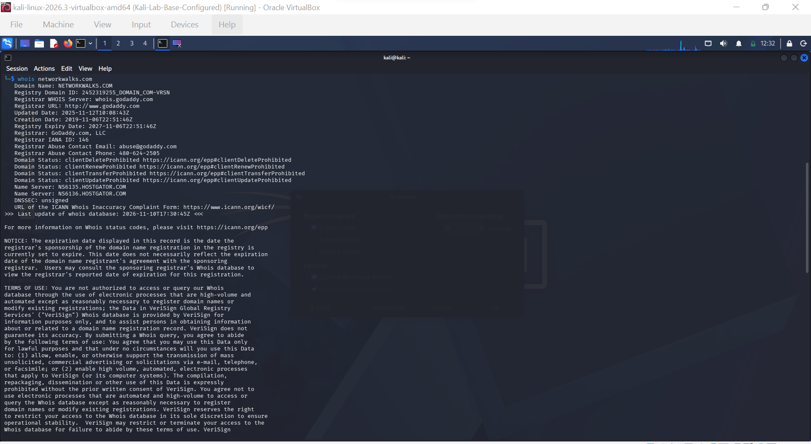
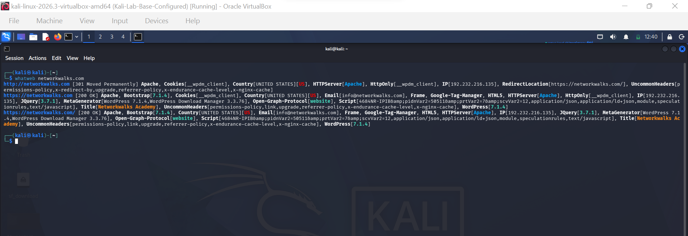
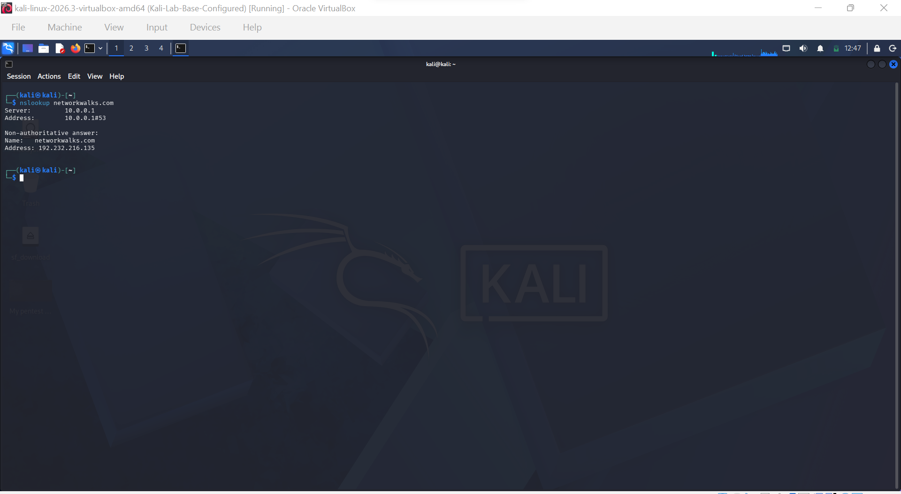
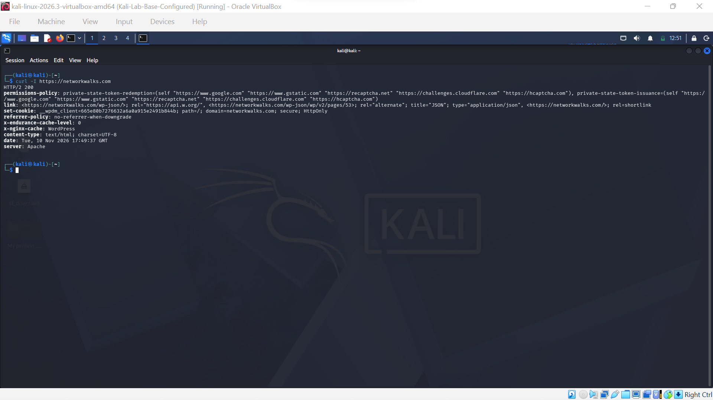
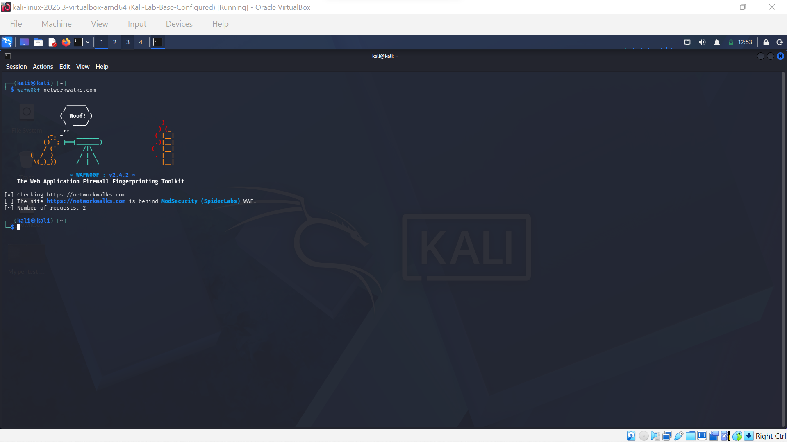
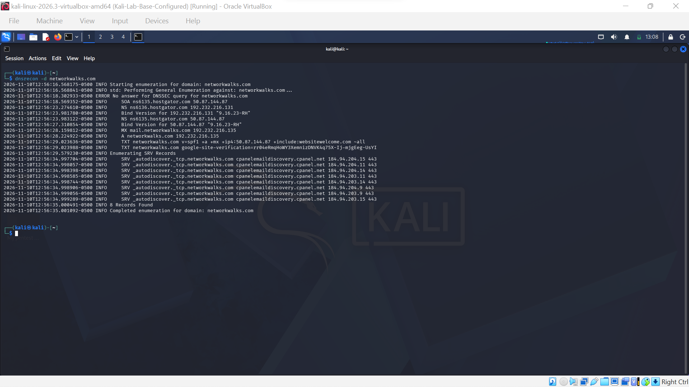
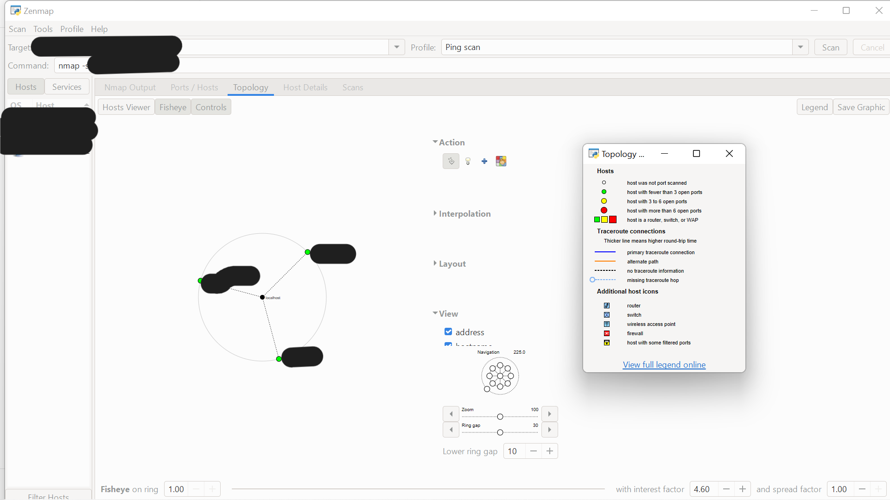

# NETWORKWALKS-B084L-WK2-PM1-PM5-FOOTPRINTING-AND-NETWORK-SCANNING


---

## 1. Project Information

| Category | Details |
|---|---|
| Author | Cecil Abotsivia |
| Program | Networkwalks Cybersecurity Internship |
| Batch | B084L |
| Project | W2-PM-FINAL |
| Modules | W2-PM1 and W2-PM5 |
| Date | 10 November 2026 |
| Operating Systems | Kali Linux and Windows |
| Project Focus | Footprinting and Network Scanning |

## 2. Project Overview

This repository documents my Week 2 practical activities as part of my ongoing Cybersecurity Internship at Networkwalks.

The project focuses on two important stages of penetration testing:

- **Footprinting and Reconnaissance:** Gathering publicly available information about a domain and identifying its web technologies and DNS infrastructure.
- **Network Scanning and Discovery:** Identifying active hosts and examining network information within my own local network using Zenmap.

The exercises provided practical experience in information gathering, DNS enumeration, web technology fingerprinting, network discovery, risk assessment and professional security documentation.

All activities were conducted within authorized testing environments.

## 3. Project Objectives

The main objectives were to:

1. Understand the fundamentals of footprinting and reconnaissance.
2. Gather publicly available domain registration information.
3. Identify web application technologies.
4. Investigate DNS records and infrastructure.
5. Inspect HTTP response headers.
6. Identify Web Application Firewall technologies.
7. Discover active devices on a local network.
8. Identify relevant IP and MAC address information.
9. Generate a network topology.
10. Document observations and recommend appropriate security improvements.

## 4. Tools and Technologies

| Tool | Purpose |
|---|---|
| Kali Linux | Security testing environment |
| WHOIS | Domain registration information gathering |
| WhatWeb | Web technology fingerprinting |
| Nslookup | DNS resolution |
| cURL | HTTP response header inspection |
| Wafw00f | Web Application Firewall detection |
| DNSRecon | DNS enumeration |
| Zenmap | Graphical network scanning and discovery |
| Nmap | Network discovery engine |
| Windows CMD | Local IP and MAC address identification |

## 5. Practical Activities Performed

### 5.1 W2-PM1 – Footprinting and Reconnaissance

I performed authorized reconnaissance against the Networkwalks domain using six Kali Linux tools.

**Activities included:**

- WHOIS: Obtained publicly available domain registration information.
- WhatWeb: Identified web application technologies.
- Nslookup: Resolved the domain name to its IP address.
- cURL: Inspected HTTP response headers.
- Wafw00f: Identified the Web Application Firewall technology.
- DNSRecon: Enumerated DNS records, including name servers, mail servers and TXT records.

**Key learning:** Different reconnaissance tools provide complementary information that helps security professionals understand the publicly visible characteristics of a web environment.

### 5.2 W2-PM5 – Network Scanning with Zenmap

I used Zenmap to perform network discovery on my own local network.

**Activities included:**

- Identifying the local IP address and subnet using Windows CMD.
- Performing a Ping Scan to identify active hosts.
- Examining discovered IP addresses and MAC addresses.
- Identifying available device information.
- Generating and saving a network topology.

**Key learning:** Network scanning helps security professionals identify active devices, understand network visibility and maintain awareness of connected systems.

## 6. Evidence and Screenshots

The following screenshots document the practical activities and observations from the exercises.

### 6.1 WHOIS – Domain Registration Lookup

**Filename:** `01-WHOIS-Domain-Lookup-Networkwalks.png`



### 6.2 WhatWeb – Web Technology Fingerprinting

**Filename:** `02-WHATWEB-Web-Technology-Fingerprinting.png`



### 6.3 Nslookup – DNS Resolution

**Filename:** `03-NSLOOKUP-DNS-Resolution.png`



### 6.4 cURL – HTTP Response Headers

**Filename:** `04-CURL-HTTP-Response-Headers.png`



### 6.5 Wafw00f – Firewall Detection

**Filename:** `05-WAFW00F-Web-Application-Firewall-Detection.png`



### 6.6 DNSRecon – DNS Enumeration

**Filename:** `06-DNSRECON-DNS-Enumeration.png`



### 6.7 Zenmap – Local Network Scanning

**Filename:** `07-ZENMAP-Local-Network-Scanning.png`



## 7. Risk Analysis and Observations

The exercises identified several potential security considerations:

| Observation | Potential Security Implication |
|---|---|
| Publicly identifiable web technologies | May assist further technology fingerprinting |
| Identifiable server IP address | Provides information about the web service infrastructure |
| Exposed HTTP technical information | May assist further enumeration |
| Identifiable WAF technology | Reveals information about security architecture |
| Public DNS infrastructure information | May assist infrastructure profiling |
| Multiple visible network hosts | Unknown devices may require investigation |
| Published contact information | May be targeted for phishing or spam |

**Important:** These are observations from information-gathering exercises, not confirmed vulnerabilities. No exploitation or vulnerability validation was performed in these two modules.

## 8. Security Recommendations

Based on the observations, the following improvements are recommended:

1. Review publicly exposed web technology information.
2. Keep CMS platforms, plugins and other software updated.
3. Review HTTP response headers.
4. Regularly audit DNS records.
5. Maintain appropriate WAF configuration and monitoring.
6. Perform regular internal network discovery.
7. Investigate unknown devices.
8. Maintain accurate network documentation.
9. Ensure all security testing is properly authorized.

## 9. Key Learning Outcomes

This practical exercise strengthened my understanding of:

- Footprinting and reconnaissance methodologies.
- Domain registration investigation.
- Web technology identification.
- DNS enumeration and analysis.
- HTTP response inspection.
- Web Application Firewall detection.
- Network scanning and host discovery.
- IP and MAC address identification.
- Security risk analysis.
- Evidence collection and technical reporting.

It also reinforced the importance of responsible cybersecurity practices and conducting assessments within an authorized scope.

## 10. Repository Structure

```text
NETWORKWALKS-B084L-WK2-PM1-PM5-FOOTPRINTING-AND-NETWORK-SCANNING/
│
├── README.md
│
├── reports/
│   └── W2-PM-FINAL-Report.pdf
│
└── screenshots/
    ├── 01-WHOIS-Domain-Lookup-Networkwalks.png
    ├── 02-WHATWEB-Web-Technology-Fingerprinting.png
    ├── 03-NSLOOKUP-DNS-Resolution.png
    ├── 04-CURL-HTTP-Response-Headers.png
    ├── 05-WAFW00F-Web-Application-Firewall-Detection.png
    ├── 06-DNSRECON-DNS-Enumeration.png
    └── 07-ZENMAP-Local-Network-Scanning.png
```

## 11. Detailed Project Report

The complete practical report, including methodology, observations, risk analysis, recommendations and supporting evidence, is maintained in the `reports/` directory.

**[View the Week 2 Penetration Testing Report](reports/W2-PM-FINAL-Report.pdf)**

## 12. Ethical and Legal Disclaimer

All activities documented in this repository were conducted on systems and devices where written permission had been secured or on personally owned networks.

This repository is intended strictly for educational, research and professional development purposes.

The information and techniques presented must not be used for unauthorized access, scanning, exploitation or any activity that violates applicable laws.

The author does not encourage or support the misuse of cybersecurity tools or knowledge.

---

## Author

**Cecil Abotsivia**  
Cybersecurity Professional | Cybersecurity Student  
Networkwalks – Batch B084L

**Professional Focus:** Cybersecurity | Ethical Hacking | Digital Forensics | Network Security

**LinkedIn:** [Connect with me](https://www.linkedin.com/in/cecil-yao-abotsivia-197390271/)

---

*Learning. Practicing. Securing. Growing.*
